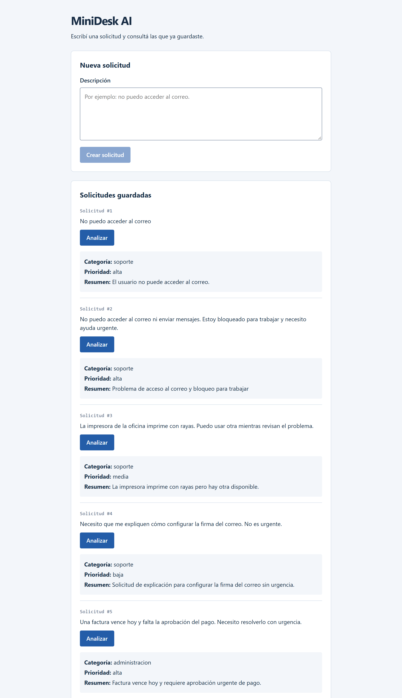

# MiniDesk AI

MiniDesk AI es una aplicación pequeña para registrar solicitudes internas, analizarlas con Gemini y guardar los resultados en SQLite. Permite consultar la descripción original, la categoría, la prioridad y el resumen de cada solicitud.

El proyecto sirve para aprender a conectar un frontend Vue 3 con TypeScript y Vite, una API Python con FastAPI, una base SQLite mediante `sqlite3` y una API de inteligencia artificial.



## Requisitos

- Node.js compatible con Vite: 20.19+ o 22.12+.
- Python 3.10 o posterior.
- Una API key de Gemini y un modelo de texto con cuota disponible en tu proyecto. Podés obtener la clave en [Google AI Studio](https://aistudio.google.com/api-keys) y consultar los modelos habilitados en [Rate limits](https://aistudio.google.com/rate-limit).

Los siguientes comandos son para Windows con PowerShell y parten de la raíz del repositorio.

## Preparar el backend

```powershell
cd backend
python -m venv .venv
.\.venv\Scripts\python.exe -m pip install -r requirements.txt
if (!(Test-Path -LiteralPath .env)) { Copy-Item -LiteralPath .env.example -Destination .env }
```

Si Windows reconoce `py` en lugar de `python`, usá `py -3 -m venv .venv`.

Completá `backend/.env` en tu editor:

```dotenv
GEMINI_API_KEY=
GEMINI_MODEL=gemini-3.5-flash-lite
```

Pegá tu clave después de `GEMINI_API_KEY=`. El modelo indicado se usó para probar el proyecto; elegí uno con cuota disponible en tu cuenta. El archivo `.env` está excluido de Git. No compartas la clave ni la pongas en el frontend.

## Ejecutar el proyecto

En una terminal, desde `backend/`:

```powershell
.\.venv\Scripts\python.exe -m uvicorn main:app --reload --host 127.0.0.1 --port 8000
```

SQLite crea automáticamente `backend/minidesk.db` y la tabla de tickets al iniciar.

En otra terminal, desde la raíz del repositorio:

```powershell
cd frontend
npm.cmd install
npm.cmd run dev
```

Abrí **http://localhost:5173**. Escribí una solicitud, pulsá **Crear solicitud** y después **Analizar** para obtener su categoría, prioridad y resumen. Cada análisis hace una llamada a Gemini y consume cuota.

Usá exactamente ese origen: CORS permite `http://localhost:5173`. Si el puerto está ocupado, Vite falla en lugar de elegir otro.

La documentación interactiva de la API está en **http://127.0.0.1:8000/docs**. Para detener cada servidor, presioná `Ctrl+C` en su terminal.

## Cargar tickets de ejemplo

Desde `backend/`:

```powershell
.\.venv\Scripts\python.exe seed.py
```

Agrega seis solicitudes sin analizar. Podés repetir el comando sin duplicar los ejemplos ni alterar los tickets existentes. Recargá la página para verlos. Esta carga no llama a Gemini.
